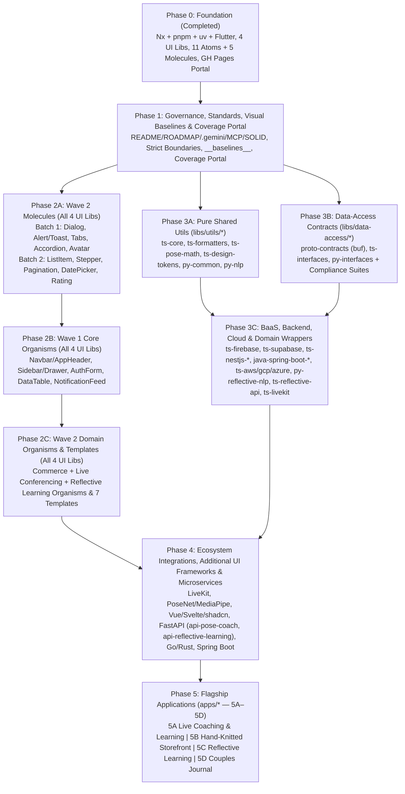

# mono-magic Roadmap

This roadmap tracks the architectural evolution and feature delivery of **`mono-magic`**. It combines:
1. A **High-Level Chronological Phase Timeline** enforcing bottom-up dependencies (e.g., `Molecules -> Core Organisms -> Domain Organisms -> Templates`, and `Utils + Data-Access Contracts -> Concrete Providers -> Applications`).
2. **Detailed Domain Checklists** with explicit deliverable acceptance criteria per item.
3. **Project Blueprints & Backlog**: Detailed application blueprints live under [`docs/projects/`](docs/projects/_TEMPLATE.md) (starting with [`docs/projects/reflective-learning.md`](docs/projects/reflective-learning.md)), while additional deferred portfolio concepts are tracked in [PORTFOLIO_IDEAS.md](PORTFOLIO_IDEAS.md).

---

## 1. Architectural Vision & Core Principles

- **Contract-First Engineering**:
  - **UI Layer (`libs/ui/*`)**: Every component tier is specified first in framework-agnostic TypeScript interfaces inside `@mono-magic/atomic-design-interfaces` (`libs/ui/atomic-design-interfaces`, tagged `scope:ui`, `type:interfaces`) and mirrored in Dart models for Flutter (`libs/ui/fl-mat`), ensuring consistent props, variants, accessibility semantics, and behavior across every framework.
  - **Data-Access Layer (`libs/data-access/*`)**: Hybrid **`buf`/Protobuf + Idiomatic Traits** design. Canonical wire DTOs, error envelopes, and pagination/filter specs live in `libs/data-access/proto-contracts` (`buf`), while idiomatic capability interfaces (`IAuthProvider`, `IDataRepository`, `IStorageProvider`, `IRealtimeProvider`, `IPaymentProvider`) and shared Contract Compliance Test Suites live in `libs/data-access/ts-interfaces` (`@mono-magic/data-access-ts-interfaces`) and `libs/data-access/py-interfaces` (`py-data-access-interfaces`) (plus future `dart-interfaces` and `java-interfaces`) before implementing concrete BaaS or backend wrappers (`ts-firebase`, `ts-supabase`, `ts-nestjs-*`, `java-spring-boot-*`, `ts-aws`, `ts-gcp`, `ts-azure`, `py-reflective-nlp`, `ts-reflective-api`, `ts-livekit`).
- **Strict 4-Domain `libs/` & `libs/<domain>/<lang>-<name>` Naming**:
  - `libs/` contains exclusively 4 domain directories: `libs/ui/`, `libs/utils/`, `libs/data-access/`, and `libs/features/`.
  - All new non-UI libraries follow `libs/<domain>/<lang>-<name>` with `scope:<domain>`, `type:<interfaces|util|data-access|feature|ui|app>`, and `lang:<ts|py|java|dart|proto|rust|go>` tags enforced by `eslint.config.mjs`.
  - `libs/utils/*` (`scope:utils`, `type:util`) is reserved strictly for pure, stateless, framework- and vendor-agnostic helper libraries (`ts-core`, `ts-formatters`, `ts-pose-math`, `ts-design-tokens`, `py-common`, `py-nlp`). Domain contracts and external I/O do **not** go in `libs/utils/`.
- **Bottom-Up Atomic Design Progression**:
  - New UI components are built strictly in tier order (`Atoms -> Molecules -> Core Organisms -> Domain Organisms -> Templates`) so higher-order components always compose tested, visually baselined primitives.
- **Polyglot Right-Tool-for-the-Job**:
  - Build microservices and shared modules in TypeScript/NestJS, Python (`uv`), Java/Kotlin (Spring Boot), Go, or Rust wherever each language excels, orchestrated uniformly by Nx and governed by [`.gemini/skills/engineering-standards/SKILL.md`](.gemini/skills/engineering-standards/SKILL.md).

---

## 2. High-Level Chronological Phase Timeline

| Phase | Milestone | Primary Directories | Dependencies | Status |
| --- | --- | --- | --- | --- |
| **Phase 0** | Monorepo Foundation, 4 UI Libraries (11 Atoms + 5 Molecules), GH Pages Portal | `libs/ui/*`, `tools/ci/*`, `.github/workflows/*` | — | Completed |
| **Phase 1** | Docs, `.gemini/` Orchestration, Strict Boundaries, Committed Visual Baselines & Coverage Portal | `README.md`, `ROADMAP.md`, `.gemini/*`, `eslint.config.mjs`, `libs/ui/*` | Phase 0 | Completed |
| **Phase 2A** | Atomic Design Expansion — Wave 2 Molecules (Batch 1: 5 + Batch 2: 5 × 4 UI Libs) | `libs/ui/atomic-design-interfaces`, `libs/ui/{react-mui,ng-mat,rn-paper,fl-mat}` | Phase 1 | Completed |
| **Phase 2B** | Atomic Design Expansion — Wave 1 Core Organisms (5 Organisms × 4 UI Libs) | `libs/ui/atomic-design-interfaces`, `libs/ui/{react-mui,ng-mat,rn-paper,fl-mat}` | Phase 2A | Planned |
| **Phase 2C** | Atomic Design Expansion — Wave 2 Domain Organisms (Commerce, Live Conferencing, Reflective Learning) & Templates | `libs/ui/atomic-design-interfaces`, `libs/ui/{react-mui,ng-mat,rn-paper,fl-mat}` | Phase 2B | Planned |
| **Phase 3A** | Pure Shared Utilities (`ts-core`, `ts-formatters`, `ts-pose-math`, `ts-design-tokens`, `py-common`, `py-nlp`, `go-core`) | `libs/utils/{ts-*,py-*,rs-*,go-*}` | Phase 1 | Completed |
| **Phase 3B** | Hybrid Data-Access Contracts (`proto-contracts`, `ts-interfaces`, `py-interfaces`) & Compliance Harness | `libs/data-access/{proto-contracts,ts-interfaces,py-interfaces}` | Phase 3A | Completed (TS/Py/Proto) |
| **Phase 3C** | Data-Access Implementations (`ts-firebase`, `ts-supabase`, `ts-nestjs-*`, `java-spring-boot-*`, Cloud SDKs, Domain Wrappers) | `libs/data-access/*` | Phase 3B | In Progress |
| **Phase 4A** | Open-Source Realtime & ML Integrations (LiveKit, PoseNet / MediaPipe, Smart Whiteboard / Transcripts, Payments) | `libs/features/ts-*`, `libs/data-access/*` | Phase 2C, 3C | Planned |
| **Phase 4B** | Additional UI Frameworks & Design Systems (Vue, Svelte, Tailwind + `shadcn/ui`) | `libs/ui/{vue-*,svelte-*,react-shadcn}` | Phase 2C | In Progress |
| **Phase 4C** | Polyglot Microservices (`api-pose-coach`, `api-reflective-learning`, Go/Rust Realtime Workers, Spring Boot, NestJS) | `apps/api-*`, `libs/data-access/*` | Phase 3C | Planned |
| **Phase 5A** | Flagship App 1: Interactive Live Coaching & Learning Platform (Yoga + PoseNet + Multi-Subject + Whiteboard) | `apps/yoga-live*` (or `apps/live-coaching*`) | Phase 2C, 4A, 4C | Planned |
| **Phase 5B** | Flagship App 2: Hand-Knitted Articles Showcase & Ordering Platform | `apps/knitted-showcase*` | Phase 2C, 3C | Planned |
| **Phase 5C** | Flagship App 3: Reflective Learning App (Wikipedia + Text/Markdown + Books/PDF/EPUB; [Blueprint](docs/projects/reflective-learning.md)) | `apps/reflective-learning*`, `apps/api-reflective-learning` | Phase 2C, 3C, 4C | Planned |
| **Phase 5D** | Flagship App 4: Couples Relationship Journal App | `apps/couples-journal*` | Phase 2C, 3C | Planned |

---

## 3. Detailed Domain Checklists & Acceptance Criteria

### Track 1: Maintenance, AI Orchestration, Visual Baselines & Coverage (`Phase 0` – `Phase 1`)

#### Completed Foundation (`Phase 0`)
- [x] **Polyglot Workspace Setup**: Nx `24.0.6`, `pnpm@12.18.0`, `uv` (`Python >=3.12`), and Flutter (`>=3.50`) with Nx Cloud CI and self-healing workflow.
- [x] **Atomic Design Contracts (`@mono-magic/atomic-design-interfaces`)**: Shared common types (`MagicColor`, `MagicSize`, `MagicAppearance`) plus contracts for 11 Atoms and 5 Molecules.
- [x] **4 Core UI Libraries (`react-mui`, `ng-mat`, `rn-paper`, `fl-mat`)**:
  - 11 Atoms: `Badge`, `Button`, `ButtonToggle`, `CheckBox`, `Chip`, `ProgressIndicator`, `RadioButton`, `SlideToggle`, `Slider`, `TextInput`, `ToolTip`.
  - 5 Molecules: `Card`, `FormField`, `Menu`, `SearchBar`, `Select`.
- [x] **Unified GitHub Pages Showcase Portal**: Automated discovery, build, and deployment via `tools/ci/storybook-pages.mjs` and `.github/workflows/storybook-gh-pages.yml` to `https://sukrutsathaye.github.io/mono-magic/`.

#### Documentation & `.gemini/` AI Orchestrator (`Phase 1.1`)
- [x] **Update `README.md`**: Fix Nx project names (`atomic-design-interfaces`, `react-mui`, `ng-mat`, `rn-paper`, `fl-mat`), replace stale `pnpm nx storybook ui-fl-mat` with `pnpm nx widgetbook fl-mat`, document all 11 Atoms & 5 Molecules, link deployed GitHub Pages showcases, and explain `storybook-addon-vis` baseline creation (`-- -u`).
- [x] **Create `ROADMAP.md`**: Establish chronological phases + domain checklists with acceptance criteria.
- [x] **Configure `.gemini/` & `.agents/` Orchestration**:
  - Add `GEMINI.md` and update `AGENTS.md` with domain boundaries, `libs/<domain>/<lang>-<name>` naming, MCP configuration (`.gemini/MCP.md`), and workflows.
  - Add custom skills in `.gemini/skills/` (`engineering-standards`, `python-uv-service`, `polyglot-ui-component`, `storybook-visual-testing`, `coverage-and-quality`, `data-access-provider`, `roadmap-tracker`) and register `.gemini/skills` + `storybook-addon-vis/skills` in `.agents/skills.json`.
  - Add custom commands in `.gemini/commands/*.toml` and specialist agent profiles in `.gemini/agents/*.md`.

#### Storybook Visual Regression Baseline Setup (`Phase 1.2`)
- [x] **Commit & Share Visual Baselines Across Environments**:
  - *Acceptance Criteria*:
    - Update `.gitignore` and `.storybook/main.ts` / `vite.config.mts` in `react-mui`, `ng-mat`, and `rn-paper` so baseline images (`__baselines__/`) are tracked in Git (while `__results__/` and `__diffs__/` remain gitignored) and resolved consistently in both local development and CI.
    - Add an explicit Nx target (`update-snapshots` or `test-storybook -u`) to regenerate baselines across all Storybook projects.
    - Generate and commit initial baseline PNGs for all stories in `react-mui`, `ng-mat`, and `rn-paper` so `pnpm nx run-many -t test-storybook -p react-mui,ng-mat,rn-paper` passes on a fresh clone and every story displays its baseline snapshot in the Storybook Web **Vis** panel.

#### Unit Test & Storybook Test Coverage Reporting (`Phase 1.3`)
- [x] **Standardize Unit Test Coverage Across JS/TS & Flutter**:
  - *Acceptance Criteria*:
    - Configure `@vitest/coverage-v8` consistently across `atomic-design-interfaces`, `react-mui`, `ng-mat`, and `rn-paper` with `reporters: ['text', 'html', 'lcov', 'json-summary']`, uniform `include`/`exclude` globs, and enforced **80% thresholds** (`lines`, `statements`, `functions`, `branches`).
    - Configure `fl-mat` `test` target (or `test-coverage` target) to run `flutter test --coverage` and produce `coverage/lcov.info` plus an HTML coverage report.
- [x] **Configure Storybook Browser Test Coverage**:
  - *Acceptance Criteria*:
    - Add a `test-storybook-coverage` target (or `--coverage` configuration on `test-storybook`) for `react-mui-storybook`, `ng-mat-storybook`, and `rn-paper-storybook` outputting HTML, LCOV, and `json-summary` reports to `test-output/storybook/coverage`.
- [x] **Publish Coverage Reports to GitHub Pages Showcase Portal**:
  - *Acceptance Criteria*:
    - Extend `tools/ci/storybook-pages.mjs` and `.github/workflows/storybook-gh-pages.yml` to collect Unit Test and Storybook Test HTML coverage reports (plus coverage percentage badges from `coverage-summary.json` / `lcov.info`) and link them directly from each project card on the GitHub Pages portal (`https://sukrutsathaye.github.io/mono-magic/`).

---

### Track 2: Polyglot UI Libraries & Atomic Design Expansion (`Phase 2` & `Phase 4B`)

> [!IMPORTANT]
> **Strict Chronological Dependency Rule**:
> Every component must be designed in `@mono-magic/atomic-design-interfaces` first, implemented across all 4 core UI libraries (`react-mui`, `ng-mat`, `rn-paper`, `fl-mat`) with unit tests (>=80% coverage), Storybook/Widgetbook stories, and visual baselines (`__baselines__`), and completed in chronological tier order: **Wave 2 Molecules $\rightarrow$ Wave 1 Core Organisms $\rightarrow$ Wave 2 Domain Organisms $\rightarrow$ Page Templates**.

#### Phase 2A — Wave 2 Molecules (Core UI Molecules)
- [x] **`Dialog` / `Modal` (`MagicDialog`)**: Header, scrollable body, action footer, sizes (`sm`, `md`, `lg`, `fullscreen`), dismiss/backdrop behavior, focus trap & ARIA dialog roles.
- [x] **`Toast` / `Snackbar` / `Alert` (`MagicAlert` & `MagicToast`)**: Severity variants (`info`, `success`, `warning`, `error`), dismissible action button, auto-hide duration, live region announcements (used for real-time PoseNet posture notifications and order alerts).
- [x] **`Tabs` (`MagicTabs`)**: Horizontal/vertical tab bar, icon + label + badge tabs, keyboard arrow navigation, lazy/eager tab panels.
- [x] **`Accordion` / `ExpansionPanel` (`MagicAccordion`)**: Single and multi-expand modes, header summary + icon + disabled state (used for product care details and yoga session breakdowns).
- [x] **`Avatar` (`MagicAvatar`)**: Image, initials fallback, icon mode, status indicator dot (`online`, `busy`, `offline`), and `MagicAvatarGroup` stack.
- [x] **`ListItem` (`MagicListItem`)**: Leading avatar/icon, primary/secondary text, trailing action/badge, selectable/interactive states.
- [x] **`Stepper` (`MagicStepper`)**: Horizontal/vertical step indicator, completed/active/error states, linear/non-linear navigation (used for multi-step checkout and onboarding).
- [x] **`Pagination` & `Breadcrumbs` (`MagicPagination`, `MagicBreadcrumbs`)**: Page size selector, page range navigation, and hierarchical breadcrumb trail.
- [x] **`DatePicker` & `TimePicker` (`MagicDatePicker`)**: Single date, date range, min/max constraints, form-field integration (used for booking live yoga sessions and delivery estimates).
- [x] **`Rating` (`MagicRating`)**: Interactive and read-only star/icon rating, half-step precision, review count label (used for hand-knitted item reviews and class ratings).

#### Phase 2B — Wave 1 Core Organisms (Composing Atoms + Wave 1/2 Molecules)
- [ ] **`Navbar` / `AppHeader` (`MagicNavbar`)**:
  - *Composes*: `Button`, `SearchBar`, `Badge`, `Avatar`, `Menu`, `ToolTip`.
  - *Acceptance Criteria*: Responsive top app bar with brand slot, navigation links, integrated `MagicSearchBar`, notification/cart badge triggers, and user profile `MagicMenu`.
- [ ] **`NavigationDrawer` / `Sidebar` (`MagicSidebar`)**:
  - *Composes*: `ListItem`, `Badge`, `Accordion`, `Button`, `ToolTip`.
  - *Acceptance Criteria*: Persistent, collapsible mini-rail, and modal drawer variants with nested navigation groups and active route highlighting.
- [ ] **`AuthForm` (`MagicAuthForm`)**:
  - *Composes*: `Card`, `FormField`, `TextInput`, `CheckBox`, `Button`, `Alert`, `Tabs`.
  - *Acceptance Criteria*: Supports Sign-In, Sign-Up, Forgot Password, and OAuth/Social provider buttons with validation states and loading indicators.
- [ ] **`DataTable` (`MagicDataTable`)**:
  - *Composes*: `CheckBox`, `Button`, `SearchBar`, `Select`, `Chip`, `Pagination`, `ProgressIndicator`, `Menu`.
  - *Acceptance Criteria*: Typed column definitions, client/server sorting, row selection, search/filter toolbar, empty/loading states, and pagination footer.
- [ ] **`NotificationFeed` / `AlertPanel` (`MagicNotificationFeed`)**:
  - *Composes*: `Card`, `ListItem`, `Avatar`, `Badge`, `Chip`, `Button`, `Tabs`.
  - *Acceptance Criteria*: Filterable real-time activity/alert stream (unread/all/critical) with action callbacks (powers teacher posture-mistake alerts in live coaching and order status updates in the Storefront app).

#### Phase 2C — Wave 2 Domain Organisms & Templates (Composing Atoms + Molecules + Core Organisms)
- [ ] **E-Commerce Organisms**:
  - `ProductCatalogGrid` (`MagicProductCatalogGrid`): Filterable/sortable responsive grid of product cards composing `Card`, `Chip`, `Rating`, `Badge`, `Button`, `SearchBar`, `Select`, and `Pagination`.
  - `CartDrawer` (`MagicCartDrawer`): Slide-over shopping cart composing `ListItem`, `Button`, quantity steppers, promo code `FormField`, and subtotal summary.
  - `CheckoutForm` (`MagicCheckoutForm`): Multi-step checkout organism composing `Stepper`, `FormField`, `TextInput`, `Select`, `RadioButton`, and `Card`.
- [ ] **Live Conferencing & Telemetry Organisms**:
  - `VideoParticipantGrid` / `MediaStage` (`MagicMediaStage`): Responsive speaker/grid video stage with participant tiles, mute/camera/screen-share `ButtonToggle` control bar, connection quality `Badge`, and pose-overlay canvas slot.
  - `PoseTelemetrySidePanel` (`MagicPoseTelemetryPanel`): Real-time student posture accuracy meter (`ProgressIndicator`, `Slider`, `Chip`), active joint-angle warnings (`Alert`), and instant teacher feedback actions.
- [ ] **Reflective Learning Organisms** (see [`docs/projects/reflective-learning.md`](docs/projects/reflective-learning.md)):
  - `TopicCatalogGrid` (`MagicTopicCatalogGrid`): Filterable/searchable catalog of study topics (`Card`, `Chip`, `Badge`, `SearchBar`) with role-aware actions (`student`, `teacher`, `admin`).
  - `ChapterReader` (`MagicChapterReader`): Paginated chapter reader (10 paragraphs/chapter) with section headings, `ProgressIndicator`, and chapter-progress tracking (`Button`).
  - `McqQuizRunner` (`MagicMcqQuizRunner`): Chapter-scoped multiple-choice assessment composing `Card`, `RadioButton`, `ProgressIndicator`, `Badge`, and misconception feedback.
  - `SubjectiveQuizRunner` (`MagicSubjectiveQuizRunner`): Open-ended definition/concept prompt with `FormField`/`TextInput`, semantic similarity `ProgressIndicator`, and rubric feedback.
  - `KeywordCurationDeck` (`MagicKeywordCurationDeck`): Teacher review deck (`Card`, `ProgressIndicator`, Approve/Reject `Button`s, `Chip` counters) with resumable queue state.
  - `QuestionCurationPanel` (`MagicQuestionCurationPanel`): Filterable question list with inline `FormField` editing and approval toggles (`SlideToggle` / `Tabs`).
  - `TopicIngestionPanel` (`MagicTopicIngestionPanel`): Multi-source ingestion launcher (Wikipedia, Raw Text/Markdown, Books/PDF/EPUB) with LLM mode toggle and SSE `ProgressIndicator`.
- [ ] **Page Templates (`src/lib/templates/`)**:
  - `AppShellTemplate` (`MagicAppShellTemplate`): Composes `Navbar`, `NavigationDrawer`, main content region, and `Toast` viewport.
  - `StorefrontTemplate` (`MagicStorefrontTemplate`): Composes `Navbar`, facet filter sidebar, `ProductCatalogGrid`, and `CartDrawer`.
  - `LiveSessionTemplate` (`MagicLiveSessionTemplate`): Composes session header, `VideoParticipantGrid` stage, collapsible `PoseTelemetrySidePanel` + `NotificationFeed`, and bottom media control bar.
  - `TopicLibraryTemplate` (`MagicTopicLibraryTemplate`): Composes `Navbar`, `SearchBar`, and `TopicCatalogGrid`.
  - `StudyReaderTemplate` (`MagicStudyReaderTemplate`): Composes `ChapterReader` and chapter-scoped quiz launcher (`Select`/`Slider`).
  - `AssessmentTemplate` (`MagicAssessmentTemplate`): Composes `McqQuizRunner`, `SubjectiveQuizRunner`, and score/rubric analysis summary.
  - `CurationWorkspaceTemplate` (`MagicCurationWorkspaceTemplate`): Composes `Tabs`, `KeywordCurationDeck`, `QuestionCurationPanel`, and `TopicIngestionPanel`.

#### Phase 4B — Additional UI Frameworks & Design Systems (`libs/ui/*`)
- [ ] **`react-shadcn` (`libs/ui/react-shadcn`)**: React 19 + Tailwind CSS + `shadcn/ui` (Radix primitives) implementing `@mono-magic/atomic-design-interfaces` + Storybook.
- [x] **`vue-ui` (`libs/ui/vue-vuetify`)**: Vue 3 + Vuetify 3 implementing 11 Atoms of `@mono-magic/atomic-design-interfaces` + Storybook (Molecules deferred to Wave 3).
- [x] **`svelte-ui` (`libs/ui/svelte-tw`)**: Svelte 5 + Tailwind / Bits UI implementing 11 Atoms of `@mono-magic/atomic-design-interfaces` + Storybook (Molecules deferred to Wave 3).

---

### Track 3: Pure Shared Utilities (`libs/utils/*` — `Phase 3A`)

> [!NOTE]
> All libraries in `libs/utils/*` must remain **stateless, framework-agnostic, and vendor-agnostic** (`scope:utils`, `type:util`, `>=90%` unit test coverage).

- [x] **`@mono-magic/utils-ts-core` (`libs/utils/ts-core`)**:
  - *Acceptance Criteria*: Functional `Result<T, E>` / `AppError` / `ErrorCode` primitives, `retryWithBackoff` (exponential backoff + jitter + `AbortSignal`), `TypedEventBus`, and `invariant` helpers with 90%+ unit test coverage.
- [x] **`@mono-magic/utils-ts-formatters` (`libs/utils/ts-formatters`)**:
  - *Acceptance Criteria*: Locale-aware currency/price/tax formatting, physical unit & dimension converters (yarn weight/length/gauge, clothing sizes), and date/duration/countdown formatters.
- [x] **`@mono-magic/utils-ts-pose-math` / `rs-utils-pose-math` (`libs/utils/rs-pose-math`)**:
  - *Acceptance Criteria*: Pure 2D/3D keypoint vector geometry (joint angle calculation between 3 landmarks, cosine similarity against reference yoga pose vectors, confidence filtering, and One-Euro / EMA temporal smoothing filters).
- [x] **`@mono-magic/utils-ts-design-tokens` / `rs-utils-design-tokens` (`libs/utils/rs-design-tokens`)**:
  - *Acceptance Criteria*: Pure WCAG 2.1 contrast-ratio calculators, color-space conversions, and multi-target design-token emitters generating CSS custom properties, React/RN theme objects, and Dart theme tokens.
- [x] **`py-utils-common` (`libs/utils/py-common`)**:
  - *Acceptance Criteria*: `uv`-managed Python utility package providing structured JSON logging, correlation-ID middleware helpers, standardized error envelopes, and Pydantic base settings.
- [x] **`py-utils-nlp` (`libs/utils/py-nlp`)**:
  - *Acceptance Criteria*: Pure, stateless Python text/NLP helpers (`clean_text`, sentence/paragraph segmentation, plural/singular normalization, algorithmic keyword extractors `yake`/`TextRank`/`TF-IDF`, `mask_keyword_in_sentence`, and `cosine_similarity` vector math) with 90%+ unit test coverage.
- [x] **`go-utils-core` (`libs/utils/go-core`)**:
  - *Acceptance Criteria*: Pure Go 1.24.3 utilities (`apperror`, `retry`, `logging`, `telemetry` sliding-window aggregator) with race-detector verified tests (95%+ unit test coverage).

---

### Track 4: Contract-First Data-Access Layer & Backend Wrappers (`libs/data-access/*` — `Phase 3B–3C`)

#### Phase 3B — Hybrid Data-Access Contracts (`libs/data-access/{proto-contracts,ts-interfaces,py-interfaces}`)
- [x] **`proto-contracts` (`libs/data-access/proto-contracts`)**:
  - *Acceptance Criteria*: Canonical Protobuf v3 schemas under `proto/monomagic/{common,auth,storage,realtime,payments}/v1/*.proto` validated by `@bufbuild/buf` (`lint`, `breaking`, `generate` Nx targets) defining shared wire DTOs, `ErrorCode`/`DataAccessError`, `QuerySpec`/`PageInfo`, `AuthSession`, `StorageObjectMeta`, `RealtimeEnvelope`, and `PaymentIntent`.
- [x] **`@mono-magic/data-access-ts-interfaces` (`libs/data-access/ts-interfaces`)**:
  - *Acceptance Criteria*:
    - Define vendor-agnostic TypeScript interfaces and abstract base classes (`IAuthProvider`, `BaseAuthProvider`, `IDataRepository<T, ID>`, `BaseDataRepository<T, ID>`, `IStorageProvider`, `IRealtimeProvider`, `IPaymentProvider`) plus portable query/filter/pagination DTOs (`QuerySpec`, `PaginatedResult`, `DataAccessError`) backed by `@mono-magic/utils-ts-core`.
    - Provide a reusable **Contract Compliance Test Suite** (`runDataRepositoryContractTests`, `runAuthProviderContractTests`, `runStorageProviderContractTests`) with in-memory reference adapters (`>=80%` coverage) that every concrete provider implementation must pass.
- [x] **`py-data-access-interfaces` (`libs/data-access/py-interfaces`)**:
  - *Acceptance Criteria*: Pydantic v2 DTOs, `typing.Protocol` / `abc.ABC` interfaces (`AuthProvider`, `DataRepository[TEntity, TId]`, `StorageProvider`, `RealtimeProvider`, `PaymentProvider`), and `pytest` compliance suite (`assert_repository_contract`, `assert_auth_contract`) with `>=80%` coverage.
- [ ] **Future Language Interface Mirrors (`libs/data-access/{dart-interfaces,java-interfaces}`)**:
  - *Acceptance Criteria*: Idiomatic Dart and Java/Kotlin trait mirrors aligned with `proto-contracts`.

#### Phase 3C.1 — BaaS Wrappers (Firebase & Supabase)
- [x] **`@mono-magic/data-access-ts-firebase` (`libs/data-access/ts-firebase`)**:
  - *Acceptance Criteria*: Implements `IAuthProvider` (Firebase Auth), `IDataRepository` (Cloud Firestore with converter & query mapping), `IStorageProvider` (Cloud Storage), and `IRealtimeProvider` (Firestore/RTDB listeners), passing the shared contract compliance suite against Firebase Emulator / mocks.
- [x] **`@mono-magic/data-access-ts-supabase` (`libs/data-access/ts-supabase`)**:
  - *Acceptance Criteria*: Implements `IAuthProvider` (Supabase Auth), `IDataRepository` (PostgREST / Postgres), `IStorageProvider` (Supabase Storage), and `IRealtimeProvider` (Supabase Realtime channels), passing the identical contract compliance suite.

#### Phase 3C.2 — NestJS Backend Wrappers (`libs/data-access/ts-nestjs-*`)
- [ ] **`@mono-magic/data-access-ts-nestjs` (`libs/data-access/ts-nestjs-core` & wrappers)**:
  - *Acceptance Criteria*: Reusable NestJS dynamic modules and decorators following official NestJS idioms:
    - Auth/OIDC/JWT Guards & Passport strategies implementing `IAuthProvider`
    - Prisma / TypeORM PostgreSQL repository adapters implementing `IDataRepository`
    - Caching (Redis), Configuration (`@nestjs/config`), OpenAPI/Swagger, Queues (`BullMQ`), and WebSockets/Microservice transport wrappers.

#### Phase 3C.3 — Enterprise Java/Kotlin Spring Boot Data-Access (`libs/data-access/java-spring-boot-*`)
- [ ] **`java-spring-boot-data-access` (`libs/data-access/java-spring-boot-starter`)**:
  - *Acceptance Criteria*: Spring Boot 3 (Java 21 / Kotlin) module providing the same domain capabilities as the Firebase/Supabase wrappers using open-source self-hosted infrastructure:
    - **Keycloak** OIDC / OAuth2 Resource Server & Admin client adapter (`IAuthProvider` equivalent)
    - **PostgreSQL** + Spring Data JPA / jOOQ + Flyway migrations (`IDataRepository` equivalent)
    - **MinIO / S3-compatible** object storage adapter (`IStorageProvider` equivalent)
    - **Redis / WebSocket / STOMP** pub-sub adapter (`IRealtimeProvider` equivalent)
    - Exposed via REST/OpenAPI + gRPC/Protobuf so any frontend or microservice can swap between Firebase, Supabase, NestJS, and Spring Boot seamlessly.

#### Phase 3C.4 — Cloud Provider & Domain Wrappers (`libs/data-access/{ts-aws,ts-gcp,ts-azure,py-reflective-nlp,ts-reflective-api,ts-livekit}`)
- [ ] **`@mono-magic/data-access-ts-aws` (`libs/data-access/ts-aws`)**: Adapters for Amazon Cognito, DynamoDB / RDS, S3, and EventBridge/IoT WebSockets.
- [ ] **`@mono-magic/data-access-ts-gcp` (`libs/data-access/ts-gcp`)**: Adapters for Google Identity Platform, Firestore / Cloud SQL / Spanner, Cloud Storage, and Pub/Sub.
- [ ] **`@mono-magic/data-access-ts-azure` (`libs/data-access/ts-azure`)**: Adapters for Microsoft Entra ID, Cosmos DB / Azure Postgres, Blob Storage, and Web PubSub.
- [x] **`py-reflective-nlp` (`libs/data-access/py-reflective-nlp`)**: Generalized `ContentSourceProvider` (`WikipediaApiSource`, Raw Text/Markdown, Books/PDF/EPUB), `FastEmbedSemanticGrader` (`BAAI/bge-small-en-v1.5`), pluggable `LLMQuestionGenerator` (`ChapterQuestionBundle`, misconception distractors, Bloom levels), and async SQLModel repositories (see [`docs/projects/reflective-learning.md`](docs/projects/reflective-learning.md)).
- [x] **`@mono-magic/data-access-ts-reflective-api` (`libs/data-access/ts-reflective-api`)**: Typed TypeScript REST + SSE client adapter implementing `IReflectiveLearningService` and `ts-interfaces`.

---

### Track 5: Realtime, ML Integrations & Polyglot Microservices (`Phase 4A` & `Phase 4C`)

- [ ] **LiveKit Conferencing Integration (`libs/data-access/ts-livekit` & `libs/features/ts-live-room`)**:
  - *Acceptance Criteria*: Server-side room management & JWT access token generator (TS/NestJS, Python, and Go/Spring Boot compatible) + client-side room connection, track publishing, Smart Whiteboard & auto-transcript data-channel hooks integrating with `MagicMediaStage`.
- [ ] **PoseNet / MediaPipe Pose Analysis Integration (`libs/features/ts-pose-detection` & `apps/api-pose-analyzer`)**:
  - *Acceptance Criteria*:
    - Client-side real-time pose landmark extractor (TensorFlow.js PoseNet / MoveNet / MediaPipe Pose for Web, React Native, and Flutter).
    - Reference pose library (Downward Dog, Warrior II, Tree Pose, Plank, etc.) using `@mono-magic/utils-ts-pose-math` to detect joint-angle deviations and emit structured mistake events over LiveKit data channels / `IRealtimeProvider`.
- [ ] **Polyglot Microservices (`apps/api-*`)**:
  - [ ] **Python (`uv` — `apps/api-pose-coach`)**: FastAPI + PyTorch/MediaPipe service with `lifespan` singletons for server-side pose session analytics, biomechanical progress scoring, and personalized correction summaries.
  - [ ] **Python (`uv` — `apps/api-reflective-learning`)**: Thin FastAPI ASGI service with `lifespan` singletons (`httpx.AsyncClient`, `spaCy`, `FastEmbedSemanticGrader`), SSE topic ingestion progress, two-tier hybrid grading, and teacher curation endpoints (see [`docs/projects/reflective-learning.md`](docs/projects/reflective-learning.md)).
  - [ ] **Go / Rust (`apps/api-realtime-telemetry`)**: High-throughput, low-latency telemetry aggregator and webhook/event router for live conferencing rooms.
  - [ ] **Java / Kotlin (`apps/api-commerce-core`)**: Spring Boot + Keycloak + PostgreSQL backend service for catalog inventory, custom knitting order workflows, and payment orchestration.
  - [ ] **NestJS (`apps/api-gateway`)**: TypeScript BFF / API Gateway unifying REST/GraphQL/WebSocket endpoints for web and mobile clients.

---

### Track 6: Flagship Applications (`apps/*` — `Phase 5A` – `Phase 5D`)

> [!NOTE]
> Additional deferred portfolio applications (8 projects requiring individual `/grill-me` design and optimization sessions) are cataloged in [PORTFOLIO_IDEAS.md](PORTFOLIO_IDEAS.md).

#### Phase 5A — Interactive Live Coaching & Learning Platform (`apps/yoga-live*`)
- [ ] **Live Conferencing, PoseNet/Gym, Reels & Multi-Subject Classroom (`apps/yoga-live-web` & `apps/yoga-live-mobile`)**:
  - *Composes*: `LiveSessionTemplate`, `VideoParticipantGrid`, `PoseTelemetrySidePanel`, `NotificationFeed`, `DatePicker`, `AuthForm`, `@mono-magic/utils-ts-pose-math`, `libs/data-access/ts-livekit`, `IPaymentProvider`, and pluggable `data-access`.
  - *Acceptance Criteria*:
    - Multi-participant live video conferencing powered by LiveKit, supporting **Yoga + Gym/Fitness** (with real-time client-side PoseNet/MoveNet skeleton tracking & automated posture mistake detection notifying instructors) as well as **Math, Science, and Languages** live tutoring sessions.
    - Short-form instructional **Reels** feed, interactive **Smart Whiteboard** with real-time drawing sync, **automated session transcripts** + lesson summaries, live **Chat**, class scheduling, and integrated **Payments / Subscriptions** (`IPaymentProvider`).
    - Full E2E test suite (Playwright for web, integration tests for mobile) and `>=80%` unit coverage.

#### Phase 5B — Hand-Knitted Articles Showcase & Ordering Platform (`apps/knitted-showcase*`)
- [ ] **Artisanal Hand-Knitted Storefront & Custom Order Studio (`apps/knitted-showcase-web` & `apps/knitted-showcase-mobile`)**:
  - *Composes*: `StorefrontTemplate`, `AppShellTemplate`, `ProductCatalogGrid`, `CartDrawer`, `CheckoutForm`, `Dialog`, `Tabs`, `Rating`, `Accordion`, `@mono-magic/utils-ts-formatters`, `IPaymentProvider`, and pluggable `data-access` (`ts-supabase`/`ts-firebase` or `java-spring-boot-*`/`ts-nestjs-*`).
  - *Acceptance Criteria*:
    - Curated showcase gallery for hand-knitted garments and accessories with high-resolution media, yarn composition badges (`Chip`), and customer reviews (`Rating`).
    - Interactive customization selector (yarn material, color palette swatches, custom measurements/sizes with `@mono-magic/utils-ts-formatters`).
    - Real-time cart drawer (`MagicCartDrawer`), multi-step checkout (`MagicCheckoutForm` + `MagicStepper`), live order crafting status tracker (*Yarn Selected $\rightarrow$ In Knitting $\rightarrow$ Blocking & QC $\rightarrow$ Shipped*), and Playwright/mobile E2E verification.

#### Phase 5C — Reflective Learning App (`apps/reflective-learning*`)
- [ ] **Reflective Knowledge Ingestion, Study & Hybrid Assessment Platform (`apps/reflective-learning-web` & `apps/reflective-learning-mobile`)**:
  - *Blueprint*: [`docs/projects/reflective-learning.md`](docs/projects/reflective-learning.md)
  - *Composes*: `TopicLibraryTemplate`, `StudyReaderTemplate`, `AssessmentTemplate`, `CurationWorkspaceTemplate`, `libs/features/ts-reflective-learning`, `libs/data-access/ts-reflective-api`, `libs/data-access/py-reflective-nlp`, `libs/utils/py-nlp`, and `apps/api-reflective-learning`.
  - *Acceptance Criteria*:
    - Multi-source content ingestion via `ContentSourceProvider`: **Wikipedia** (MediaWiki Action API), **Raw Text / Markdown**, and **Books / PDF / EPUB** with non-blocking SSE progress streaming and migration support for legacy `.pkl` topic exports.
    - Paginated chapter reader (`10` paragraphs/chapter), chapter-gated MCQ quizzes (shuffled options, misconception distractors), and open-ended subjective assessments.
    - **Two-Tier Hybrid Grading**: Tier 1 local ONNX `fastembed` cosine similarity (`<15ms`, zero API cost) + Tier 2 optional LLM rubric evaluation for borderline scores (`0.15–0.82`) or on-demand explanation, plus teacher keyword/question curation workflows.
    - ASGI E2E (`httpx.AsyncClient` + `ASGITransport`) and Playwright/mobile E2E suites verified.

#### Phase 5D — Couples Relationship Journal App (`apps/couples-journal*`)
- [ ] **Private Shared Reflection, Prompts & Milestone Journal (`apps/couples-journal-web` & `apps/couples-journal-mobile`)**:
  - *Composes*: `AppShellTemplate`, `AuthForm`, `Card`, `Dialog`, `Tabs`, `DatePicker`, `Toast`, `IAuthProvider`, `IDataRepository`, `IStorageProvider`, `IRealtimeProvider`, and `@mono-magic/utils-ts-core`.
  - *Acceptance Criteria*:
    - Paired private workspace with invite/linking flow, daily guided prompts, shared & private journal entries, photo/memory attachments (`IStorageProvider`), mood check-ins, and realtime partner sync (`IRealtimeProvider`).
    - Strict privacy/access isolation tests, unit coverage `>=80%`, and Playwright/mobile E2E tests.
