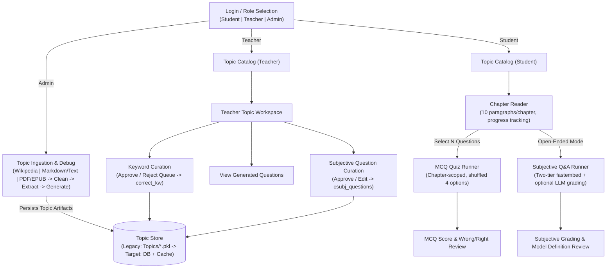

# Reflective Learning Application — Migration & Architecture Blueprint in `mono-magic`

- **Status**: `Blueprint Preserved — Scheduled for Wave 2+ / Phase 5C` (Intentionally deferred until core `libs/data-access/*` and `libs/ui/*` foundations are complete)
- **Target Phases**: `Phase 2C`, `Phase 3A`, `Phase 3C`, `Phase 4C`, `Phase 5C` ([ROADMAP.md](../../ROADMAP.md))
- **Primary Domains**: `libs/utils/py-nlp`, `libs/data-access/{proto-contracts,ts-interfaces,py-interfaces,py-reflective-nlp,ts-reflective-api}`, `libs/features/ts-reflective-learning`, `libs/ui/*`, `apps/{api-reflective-learning,reflective-learning-web,reflective-learning-mobile}`
- **Target Monorepo**: [`sukrutsathaye/mono-magic`](https://github.com/sukrutsathaye/mono-magic) (Nx `v24`, `pnpm`, `uv` Python `>=3.12`, Atomic Design polyglot UI libraries)
- **Source Legacy App**: `ReflectiveLearningApplication` (2020–2021 Python + Kivy + pre-LLM NLP prototype)

---

## 1. Executive Summary & Migration Objectives

The original **Reflective Learning Application** (2020–2021) automated topic ingestion from Wikipedia, extracted domain keywords using classical graph/statistical NLP (`spaCy`, `textacy`, `RAKE`, `TF-IDF`), generated fill-in-the-blank MCQs with distractor options (`PowerThesaurus` via Selenium + `GloVe` 300d embeddings), generated open-ended definition questions, and graded student free-text answers semantically using Universal Sentence Encoder (`en_use_lg`), all wrapped in a stateful desktop **Kivy** UI backed by local `.pkl` files.

### Why & How We Migrate (Including Generalized Content Sources)
1. **Decouple Frontend from Backend**: Replace monolithic Kivy screens (`user_interface/*.py` + `*.kv`) that directly instantiate NLP models and read `.pkl` files with a clean **Client–API–Domain** boundary using `mono-magic`'s **contract-first `libs/data-access/*`** and **Atomic Design `libs/ui/*`** (`react-mui`, `ng-mat`, `rn-paper`, `fl-mat`).
2. **Generalize Ingestion Beyond Wikipedia (`ContentSourceProvider`)**: Extend topic ingestion via an Open/Closed `ContentSourceProvider` `Protocol` supporting **Wikipedia** (MediaWiki Action API), **Raw Text / Markdown**, and **Books / PDF / EPUB** documents normalized into uniform `ParagraphDTO` chapters.
3. **Eliminate Latency & Resource Bottlenecks**:
   - Remove **Selenium + ChromeDriver** scraping (`OptionGenerator.py`) in favor of async HTTP APIs (`httpx`) + fast local embeddings / optional LLM providers.
   - Load ML/NLP models **once** via FastAPI `lifespan` singletons instead of per-class-instantiation (`spacy.load`, `gensim.downloader.load`, `sent_encoder.load_model`).
   - Replace ~1–2 GB legacy models (`glove-wiki-gigaword-300`, `en_use_lg`) with lightweight ONNX/quantized sentence embeddings (`fastembed` / `BAAI/bge-small-en-v1.5` or `all-MiniLM-L6-v2`) and **pluggable LLM strategies** (structured JSON output).
4. **Replace Pickle Persistence & Global State**: Migrate `Topics/<topic>/*.pkl` and module globals (`sm`, `chapters_read`) to **PostgreSQL / SQLite (SQLModel / SQLAlchemy 2.0 async)** + **Pydantic v2** schemas and stateless REST/SSE endpoints.
5. **Fix All 6 Legacy Bugs During Migration**:
   - `ScrapeText.get_raw_text()`: `zip(paras, heads)` interleaved mismatched headings/paragraphs and dropped trailing paragraphs when counts differed.
   - `ProcessText`: mutating `self.paragraphs` / `self.text_per_para` with `.pop()` during `enumerate()`; `normalize_case()` reassigned loop variable `words = words.lower()` without mutating list items; `remove_punctuations()` discarded `re.sub()` return values.
   - `ExtractKeyWords.get_kw_freq()`: used a single shared counter `i` across all keywords instead of per-keyword frequency counts.
   - `CorrectKWScreen`: incremented `self.srno += 1` while calling `self.updated_unchecked.remove(...)`, skipping every other keyword during teacher review.
   - `StudentTopic` / `SubjectiveQuestionScreen`: referenced undefined `rl.qag` / `self.rl.qag` fallback when `.pkl` files were absent.
   - `MainScreen`: hardcoded plaintext credentials (`'s': '1'`, `'t': 'a'`, `'a': 'q'`).

---

## 2. Key Features & End-to-End Flows (Legacy System Inventory)

### 2.1 User Roles & Authentication (`MainScreen`)
- **Roles**:
  - **Student (`s`)**: Browse topics, read paginated chapters, take chapter-scoped MCQ quizzes, answer subjective definition questions, view score & semantic grading analysis.
  - **Teacher (`t`)**: Browse topics, curate auto-extracted keywords (approve/reject with resumable progress), inspect generated questions, approve or rewrite subjective questions.
  - **Admin (`a`)**: Ingest new topics (Wikipedia, Raw Text/Markdown, PDF/EPUB → NLP pipeline → artifacts) and run extractor comparison diagnostics (`DebugScreen`).

### 2.2 System Flow Diagram



### 2.3 Feature-by-Feature Breakdown

| Domain Feature | Legacy Implementation | Inputs / State | Outputs / Persistence |
| --- | --- | --- | --- |
| **1. Topic Scraping / Ingestion** | `ScrapeText` (`ReflectiveLearningV7.py`) | Topic title (`"Black Hole"`); *Wave 2+ extends via `ContentSourceProvider` for Raw Text/Markdown & PDF/EPUB* | Wikipedia HTML `<p>` & `mw-headline` spans (Target: MediaWiki JSON / Markdown headings / PDF-EPUB chapters) |
| **2. Text Cleaning & Segmentation** | `ProcessText` (`ReflectiveLearningV7.py`) | Raw HTML paragraphs / source blocks | `text.pkl` (`list[str]` paragraphs > 70 chars / > 20 chars), sentence splitting |
| **3. Multi-Algo Keyword Extraction & POS Filtering** | `ExtractKeyWords` (`ReflectiveLearningV7.py`) | `spacy` `en_core_web_lg` + `textacy` (`TextRank`, `SGRank`, `YAKE`, `sCAKE`) + `RAKE` + `TF-IDF` | `keywords.pkl` (per paragraph), `people_names.pkl` (`PROPN PROPN` sequences), `similar_words.pkl` |
| **4. Fill-in-the-Blank Question Generation** | `QuestionAnswerGenerator.generate_blank_questions()` | Filtered keywords + sentences per paragraph | `questions.pkl` (`list[list[tuple[kw, blanked_sentence]]]`) |
| **5. MCQ Distractor Generation** | `generate_mcq_options()` + `PowerTheasurus` (`OptionGenerator.py`) + `GloVe` | Keywords, `people_names`, PowerThesaurus Selenium scrape, `glove-wiki-gigaword-300` | `options.pkl` (`dict[kw, [correct, d1, d2, d3]]`, index `0` is always correct before UI shuffle) |
| **6. Subjective Question & Model Answer Extraction** | `generate_questions_top_kw()` / `get_all_subjective_questions_answers()` | Keyword frequencies (`get_top_keywords`) + `people_names` | `subj_questions.pkl` (`("Who/What is <kw>?")`), `subj_answers.pkl` (up to 3 source sentences per keyword) |
| **7. Student Chapter Reader** | `StudentTopic` (`student_topic.py`) | `text.pkl`, `one_chapter = 10` paragraphs | Tracks `chapters_read` to gate quiz question pool |
| **8. Student MCQ Quiz & Analysis** | `PopUpQues`, `QuestionAnswerScreen`, `AnalysisScreen` | `questions.pkl` (filtered by `correct_kw.pkl` if curated), `options.pkl`, `n_of_ques`, `chapters_read` | Score (`correct / total`), list of missed Qs + correct answers, list of correct Qs |
| **9. Student Subjective Quiz & Semantic Grading** | `SubjectiveQuestionScreen`, `DefQuesAnalysisScreen`, `SubQuesChecker` | `csubj_questions.pkl` (or `subj_questions.pkl`), `subj_answers.pkl`, `en_use_lg` | Cosine similarity banded into 4 verdicts: `>=0.75`, `0.40–0.75`, `0.20–0.40`, `<0.20` |
| **10. Teacher Keyword & Question Curation** | `TeacherTopic`, `CorrectKWScreen`, `DispQuestions`, `CorrectSQScreen` | `keywords.pkl`, `questions.pkl`, `subj_questions.pkl` | Resumable `unchecked_kw.pkl` / `checked_kw.pkl` → `correct_kw.pkl`; `csubj_questions.pkl` |

### 2.4 Legacy Pickle Data Schemas (`Topics/<TopicName>/*.pkl`)

Verified against `Topics/Black Hole/`:
- `text.pkl`: `list[str]` — cleaned paragraphs (`len=94` for Black Hole).
- `keywords.pkl`: `list[list[str]]` — filtered keywords aligned by paragraph index.
- `people_names.pkl`: `list[str]` — multi-word proper-noun candidates.
- `similar_words.pkl`: `dict[str, list[str]]` — noun-to-compound-keyword index.
- `questions.pkl`: `list[list[tuple[str, str]]]` — `(keyword, "Sentence with ____ blank.")` per paragraph.
- `options.pkl`: `dict[str, list[str]]` — `keyword -> [correct_answer, distractor_1, distractor_2, distractor_3]`.
- `subj_questions.pkl`: `list[tuple[str, str]]` — `(keyword, "What is <kw> ?")` or `"Who is <kw> ?"`.
- `subj_answers.pkl`: `dict[str, list[str]]` — `keyword -> [sentence_1, sentence_2, sentence_3]`.
- `unchecked_kw.pkl` / `checked_kw.pkl` / `correct_kw.pkl`: `list[str]` — teacher curation state & final approved keywords.
- `csubj_questions.pkl`: `list[tuple[str, str]]` — teacher-approved/edited subjective questions.

---

## 3. Target Architecture in `mono-magic`

Following `mono-magic`'s strict 4-domain `libs/` layout and `libs/<domain>/<lang>-<name>` naming standard ([GEMINI.md](../../GEMINI.md), [ROADMAP.md](../../ROADMAP.md), and [engineering-standards](../../.gemini/skills/engineering-standards/SKILL.md)):

```text
mono-magic/
├── apps/
│   ├── api-reflective-learning/        # Thin deployable FastAPI ASGI service (scope:app, lang:py)
│   ├── reflective-learning-web/        # React 19 (or Angular 22) web app (scope:app, lang:ts)
│   └── reflective-learning-mobile/     # Flutter (or Expo RN) mobile app (scope:app)
├── libs/
│   ├── utils/
│   │   └── py-nlp/                     # Pure, stateless Python text/NLP/math utilities (scope:utils, type:util, lang:py)
│   ├── data-access/
│   │   ├── proto-contracts/            # Shared Protobuf/buf wire schemas (scope:data-access, type:interfaces, lang:proto)
│   │   ├── ts-interfaces/              # IAuthProvider, IDataRepository<T, ID>, IRealtimeProvider (lang:ts)
│   │   ├── py-interfaces/              # Python Protocols & compliance harness (lang:py)
│   │   ├── py-reflective-nlp/          # ContentSourceProvider, NLP/LLM orchestration, ONNX grader, SQLModel repos (lang:py)
│   │   └── ts-reflective-api/          # Typed REST + SSE client adapter implementing IReflectiveLearningService (lang:ts)
│   ├── features/
│   │   └── ts-reflective-learning/     # Domain state, hooks/stores, DTO mappers (scope:features, lang:ts)
│   └── ui/
│       ├── atomic-design-interfaces/   # Framework-agnostic TS contracts (Atoms, Molecules, Organisms, Templates)
│       ├── react-mui/                  # React 19 + MUI Material + Storybook
│       ├── ng-mat/                     # Angular 22 + Angular Material + Storybook
│       ├── rn-paper/                   # Expo/RN + RN Paper + Storybook
│       └── fl-mat/                     # Flutter Material 3 + Widgetbook
```

### Why `api-reflective-learning` Lives Inside `apps/` (and What Moves to `libs/utils/py-nlp`)

1. **Why `apps/api-reflective-learning` is in `apps/`**:
   - In Nx and `mono-magic`'s root `pyproject.toml` (`members = ["apps/api-*", "libs/*/py-*"]`, matching `apps/api-pose-coach` in `ROADMAP.md`), **`apps/` contains deployable runtime entrypoints** (web apps, mobile apps, and backend microservices), whereas **`libs/` contains reusable libraries** imported by apps.
   - `apps/api-reflective-learning` stays a **thin deployable shell** (FastAPI bootstrap, `uvicorn`, `lifespan` dependency wiring, HTTP/SSE routes, Docker/env config) that is never imported by other packages, while all reusable domain logic lives in `libs/`.
2. **What Moves to `libs/utils/py-nlp` vs `libs/data-access/py-reflective-nlp`**:
   - Per `GEMINI.md` and `eslint.config.mjs` (`scope:utils`, `type:util`), `libs/utils/py-nlp` must remain **pure, stateless, framework-agnostic, and vendor-agnostic** (zero HTTP calls, zero DB/SDK state, zero domain contracts, `>=90%` pytest coverage):
     - **Move to `libs/utils/py-nlp`**: `clean_text()` / regex citation stripping, sentence/paragraph segmentation (`sentences_per_paragraph()`), `plural_to_singular()` / `singular_to_plural()`, pure algorithmic keyword extractors (`yake` / `TextRank` / `TF-IDF` on raw strings), `mask_keyword_in_sentence()` blanking, and `cosine_similarity(v1, v2)` vector math.
     - **Keep OUT of `libs/utils` → put in `libs/data-access/py-reflective-nlp`**: `ContentSourceProvider` implementations (`WikipediaApiSource` performing external HTTP I/O, `MarkdownTextSource`, `DocumentBookSource` for PDF/EPUB), LLM SDK clients (OpenAI/Gemini/Ollama credentials & rate limits), embedding/spaCy model singletons (`lifespan` state), and async SQLModel repositories.

### Architectural Principles
1. **Contract-First Data Access**: Frontends never call `fetch()` ad hoc or know whether storage is SQLite, PostgreSQL, Supabase, or FastAPI. `libs/features/ts-reflective-learning` depends on `IDataRepository` / `IAuthProvider` (`@mono-magic/data-access-ts-interfaces`) and a domain service interface (`IReflectiveLearningService`).
2. **Strict Bottom-Up Atomic Design Parity**: Every UI contract added to `libs/ui/atomic-design-interfaces` (Organisms & Templates) is composed from the Atoms and Molecules already implemented across `react-mui`, `ng-mat`, `rn-paper`, and `fl-mat`.
3. **Hybrid Pre-LLM + LLM Engine**: The Python backend supports deterministic local NLP (ultra-fast, zero API cost, offline-capable) AND LLM-powered structured generation (conceptual questions, misconception-based distractors, rubric-based grading feedback) behind clean Python `Protocol` interfaces.

---

## 4. Backend Modernization in Latest Python (`>=3.12`)

### 4.1 Performance & Efficiency Upgrades

| Pipeline Step | 2020–21 Bottleneck | Modern Python (`>=3.12`) Replacement | Speed / Quality Gain |
| --- | --- | --- | --- |
| **Content Ingestion (`Wikipedia` + `Markdown/Text` + `PDF/EPUB`)** | `requests.get` + BeautifulSoup HTML scrape (Wikipedia-only) | Pluggable `ContentSourceProvider` `Protocol`: `httpx.AsyncClient` MediaWiki Action API, heading-aware Markdown/raw text parser, and async PDF/EPUB extractor (`pypdf`/`ebooklib` via `asyncio.to_thread`) | ~10–50x faster, structured sections, multi-source ready, zero HTML nav noise |
| **Text Processing** | Python `for` loops calling `self.nlp(para)` synchronously | `spaCy` `en_core_web_sm` or `md` with `nlp.pipe(texts, batch_size=32)` via `asyncio.to_thread` / or LLM chunking | ~5–10x faster, preserves paragraph–heading alignment |
| **Keyword Extraction** | 4 separate `textacy.ke` passes (`TextRank`, `SGRank`, `YAKE`, `sCAKE`) + `RAKE` | Single-pass `yake` + `spaCy` noun-chunk/NER filtering (or `KeyBERT` / structured LLM extraction) | ~4–8x faster, eliminates redundant graph construction |
| **Distractor Generation** | **Selenium ChromeDriver** scraping PowerThesaurus + loading 1.3 GB `glove-wiki-gigaword-300` | **Tier 1**: Local WordNet / Datamuse async API (`httpx`) <br>**Tier 2**: Same-topic/POS-matched embedding nearest neighbors (`fastembed`) <br>**Tier 3 (Optional)**: LLM structured JSON distractors | ~100x faster, zero browser process, higher pedagogical quality |
| **Subjective Grading** | TensorFlow Hub `en_use_lg` (~1 GB RAM, slow cold load) | `fastembed` (`BAAI/bge-small-en-v1.5` ONNX, ~65 MB) cosine similarity + optional LLM rubric feedback | <15 ms per answer, ~15x smaller memory footprint |
| **Persistence & State** | Blocking `pickle.load/dump` on local filesystem | `SQLModel` / `SQLAlchemy 2.0` async (`aiosqlite` / `asyncpg`) + `Pydantic v2` + Redis/TTL cache | Concurrent multi-user safe, queryable, zero pickle security risk |
| **Long Ingestion UX** | UI froze while `NewTopicCreator` ran in `__init__` | FastAPI `BackgroundTasks` / `Taskiq` + **Server-Sent Events (SSE)** progress stream | Non-blocking UI with real-time progress indicator |

### 4.2 `uv` Workspace Setup (`libs/utils/py-nlp`, `libs/data-access/py-reflective-nlp` & `apps/api-reflective-learning`)

In `mono-magic`, root [pyproject.toml](../../pyproject.toml) configures `[tool.uv.workspace] members = ["apps/api-*", "libs/*/py-*"]` with `requires-python = ">=3.12"` (see [python-uv-service](../../.gemini/skills/python-uv-service/SKILL.md) for `ruff`, `pyright`, and `pytest --cov` Nx targets).

```toml
# apps/api-reflective-learning/pyproject.toml
[project]
name = "api-reflective-learning"
version = "0.1.0"
requires-python = ">=3.12"
dependencies = [
    "fastapi>=0.115.0",
    "uvicorn[standard]>=0.32.0",
    "pydantic>=2.10.0",
    "pydantic-settings>=2.6.0",
    "sqlmodel>=0.0.22",
    "aiosqlite>=0.20.0",
    "httpx>=0.28.0",
    "py-data-access-interfaces",
    "py-reflective-nlp",
]

[tool.uv.sources]
py-data-access-interfaces = { workspace = true }
py-reflective-nlp = { workspace = true }
```

```toml
# libs/data-access/py-reflective-nlp/pyproject.toml
[project]
name = "py-reflective-nlp"
version = "0.1.0"
requires-python = ">=3.12"
dependencies = [
    "httpx>=0.28.0",
    "pydantic>=2.10.0",
    "spacy>=3.8.0",
    "fastembed>=0.5.0",
    "numpy>=2.1.0",
    "py-data-access-interfaces",
    "py-utils-nlp",
]

[project.optional-dependencies]
llm = ["openai>=1.58.0", "google-genai>=1.0.0"]
books = ["pypdf>=5.0.0", "ebooklib>=0.18"]

[tool.uv.sources]
py-data-access-interfaces = { workspace = true }
py-utils-nlp = { workspace = true }
```

### 4.3 Skeleton: Domain Models & Strategy Protocols (`libs/data-access/py-reflective-nlp`)

```python
# libs/data-access/py-reflective-nlp/src/py_reflective_nlp/schemas.py
from __future__ import annotations

from datetime import datetime
from enum import StrEnum
from uuid import UUID, uuid4
from pydantic import BaseModel, Field


class SourceKind(StrEnum):
    WIKIPEDIA = "wikipedia"
    RAW_TEXT = "raw_text"
    MARKDOWN = "markdown"
    PDF = "pdf"
    EPUB = "epub"


class IngestionStatus(StrEnum):
    PENDING = "pending"
    SCRAPING = "scraping"
    EXTRACTING = "extracting"
    GENERATING = "generating"
    READY = "ready"
    FAILED = "failed"


class GradeBand(StrEnum):
    CORRECT = "correct"            # similarity >= 0.75
    LIKELY_CORRECT = "likely_ok"   # 0.40 <= similarity < 0.75
    LIKELY_WRONG = "likely_wrong"  # 0.20 <= similarity < 0.40
    WRONG = "wrong"                # similarity < 0.20


class ParagraphDTO(BaseModel):
    index: int
    heading: str | None = None
    text: str


class ContentSourceRequest(BaseModel):
    kind: SourceKind
    title: str
    query_or_uri: str | None = None
    raw_content: str | None = None
    content_bytes_path: str | None = None


class KeywordDTO(BaseModel):
    id: UUID = Field(default_factory=uuid4)
    term: str
    paragraph_indices: list[int]
    is_person: bool = False
    pos_pattern: str = ""
    frequency: int = 1
    approved: bool | None = None  # None = pending, True/False = teacher decision


class MCQQuestionDTO(BaseModel):
    id: UUID = Field(default_factory=uuid4)
    paragraph_index: int
    keyword: str
    prompt: str                   # Sentence with ____ blank or self-contained stem
    correct_answer: str
    distractors: list[str] = Field(min_length=3, max_length=3)
    approved: bool = True


class SubjectiveQuestionDTO(BaseModel):
    id: UUID = Field(default_factory=uuid4)
    keyword: str
    prompt: str                   # "What is ...?" / "Who is ...?" / "Why ...?"
    reference_sentences: list[str]
    approved: bool = True


class SubjectiveGradeResult(BaseModel):
    question_id: UUID
    similarity_score: float = Field(ge=0.0, le=1.0)
    band: GradeBand
    feedback: str | None = None   # Populated by LLM grader or template explanation
    reference_answer: str


class TopicSummaryDTO(BaseModel):
    id: UUID
    title: str
    slug: str
    source_kind: SourceKind = SourceKind.WIKIPEDIA
    paragraph_count: int
    keyword_count: int
    approved_keyword_count: int
    status: IngestionStatus
    updated_at: datetime
```

```python
# libs/data-access/py-reflective-nlp/src/py_reflective_nlp/protocols.py
from __future__ import annotations

from typing import Protocol
from .schemas import (
    ContentSourceRequest,
    KeywordDTO,
    ParagraphDTO,
    SourceKind,
    SubjectiveGradeResult,
    SubjectiveQuestionDTO,
)


class ContentSourceProvider(Protocol):
    """Open/Closed ingestion strategy supporting Wikipedia, Text/Markdown, and PDF/EPUB."""

    @property
    def supported_kinds(self) -> tuple[SourceKind, ...]: ...

    async def fetch_paragraphs(self, source: ContentSourceRequest) -> list[ParagraphDTO]: ...


class KeywordExtractor(Protocol):
    async def extract(self, paragraphs: list[ParagraphDTO]) -> list[KeywordDTO]: ...


class DistractorGenerator(Protocol):
    async def generate(
        self,
        keyword: KeywordDTO,
        context_sentence: str,
        candidate_pool: list[KeywordDTO],
    ) -> list[str]: ...


class SemanticGrader(Protocol):
    async def grade(
        self,
        question: SubjectiveQuestionDTO,
        user_answer: str,
    ) -> SubjectiveGradeResult: ...
```

### 4.4 Skeleton: Generalized Source Providers & ONNX Semantic Grader (`libs/data-access/py-reflective-nlp`)

Concrete `ContentSourceProvider` strategies extend ingestion cleanly without modifying orchestration logic:
- **`WikipediaApiSource`** (`SourceKind.WIKIPEDIA`): Async MediaWiki Action API (`extracts`).
- **`MarkdownTextSource`** (`SourceKind.RAW_TEXT`, `SourceKind.MARKDOWN`): Heading-aware (`#`, `##`, `###`) section splitter using `libs/utils/py-nlp` cleaning & paragraph segmentation.
- **`DocumentBookSource`** (`SourceKind.PDF`, `SourceKind.EPUB`): Offloads `pypdf` / `ebooklib` extraction via `asyncio.to_thread` into section-tagged `ParagraphDTO` chapters.

```python
# libs/data-access/py-reflective-nlp/src/py_reflective_nlp/providers/wikipedia.py
from __future__ import annotations

import re
import httpx
from ..schemas import ContentSourceRequest, ParagraphDTO, SourceKind

_CITE_RE = re.compile(r"\[\d+\]|\[citation needed\]")


class WikipediaApiSource:
    """Replaces legacy BeautifulSoup HTML scraping with MediaWiki Action API."""

    BASE_URL = "https://en.wikipedia.org/w/api.php"
    supported_kinds = (SourceKind.WIKIPEDIA,)

    def __init__(self, client: httpx.AsyncClient) -> None:
        self._client = client

    async def fetch_paragraphs(self, source: ContentSourceRequest) -> list[ParagraphDTO]:
        topic = (source.query_or_uri or source.title).strip()
        params = {
            "action": "query",
            "prop": "extracts",
            "explaintext": "1",
            "redirects": "1",
            "titles": topic,
            "format": "json",
            "formatversion": "2",
        }
        resp = await self._client.get(
            self.BASE_URL,
            params=params,
            headers={"User-Agent": "ReflectiveLearningApp/2.0 (mono-magic)"},
            timeout=15.0,
        )
        resp.raise_for_status()
        pages = resp.json().get("query", {}).get("pages", [])
        if not pages or pages[0].get("missing"):
            raise ValueError(f"Topic not found on Wikipedia: {topic!r}")

        raw_extract: str = pages[0].get("extract", "")
        paragraphs: list[ParagraphDTO] = []
        current_heading: str | None = "Introduction"
        idx = 0

        for block in raw_extract.splitlines():
            line = _CITE_RE.sub("", block).strip()
            if not line:
                continue
            if line.startswith("==") and line.endswith("=="):
                current_heading = line.strip("= ").strip()
                continue
            if len(line) < 70:
                continue
            paragraphs.append(ParagraphDTO(index=idx, heading=current_heading, text=line))
            idx += 1
        return paragraphs
```

```python
# libs/data-access/py-reflective-nlp/src/py_reflective_nlp/providers/grading.py
from __future__ import annotations

import asyncio
import numpy as np
from fastembed import TextEmbedding
from ..schemas import GradeBand, SubjectiveGradeResult, SubjectiveQuestionDTO


class FastEmbedSemanticGrader:
    """Lightweight ONNX replacement for TensorFlow Hub en_use_lg."""

    def __init__(self, model_name: str = "BAAI/bge-small-en-v1.5") -> None:
        self._model = TextEmbedding(model_name=model_name)

    @staticmethod
    def _band(score: float) -> GradeBand:
        if score >= 0.75:
            return GradeBand.CORRECT
        if score >= 0.40:
            return GradeBand.LIKELY_CORRECT
        if score >= 0.20:
            return GradeBand.LIKELY_WRONG
        return GradeBand.WRONG

    def _score_sync(self, ref_text: str, user_text: str) -> float:
        if not user_text.strip() or not ref_text.strip():
            return 0.0
        v1, v2 = list(self._model.embed([ref_text, user_text]))
        denom = float(np.linalg.norm(v1) * np.linalg.norm(v2))
        if denom == 0.0:
            return 0.0
        return float(np.clip(np.dot(v1, v2) / denom, 0.0, 1.0))

    async def grade(
        self,
        question: SubjectiveQuestionDTO,
        user_answer: str,
    ) -> SubjectiveGradeResult:
        reference = " ".join(question.reference_sentences)
        score = await asyncio.to_thread(self._score_sync, reference, user_answer)
        band = self._band(score)
        return SubjectiveGradeResult(
            question_id=question.id,
            similarity_score=round(score, 4),
            band=band,
            reference_answer=reference,
            feedback=f"Semantic match: {score:.0%} ({band.value})",
        )
```

### 4.5 Skeleton: FastAPI Service with `lifespan` Singletons & Async Routes (`apps/api-reflective-learning`)

```python
# apps/api-reflective-learning/src/api_reflective_learning/main.py
from __future__ import annotations

from collections.abc import AsyncIterator
from contextlib import asynccontextmanager
from dataclasses import dataclass
from uuid import UUID
import httpx
import spacy
from fastapi import BackgroundTasks, Depends, FastAPI, HTTPException, Request
from pydantic import BaseModel

from py_reflective_nlp.protocols import ContentSourceProvider
from py_reflective_nlp.providers.grading import FastEmbedSemanticGrader
from py_reflective_nlp.providers.wikipedia import WikipediaApiSource
from py_reflective_nlp.schemas import SourceKind, SubjectiveGradeResult


@dataclass(slots=True)
class AppState:
    http_client: httpx.AsyncClient
    nlp: spacy.language.Language
    source_registry: dict[SourceKind, ContentSourceProvider]
    grader: FastEmbedSemanticGrader


@asynccontextmanager
async def lifespan(app: FastAPI) -> AsyncIterator[None]:
    http_client = httpx.AsyncClient()
    nlp = spacy.load("en_core_web_sm", disable=["lemmatizer"])
    wiki_source = WikipediaApiSource(http_client)
    app.state.services = AppState(
        http_client=http_client,
        nlp=nlp,
        source_registry={
            SourceKind.WIKIPEDIA: wiki_source,
            # Register MarkdownTextSource and DocumentBookSource (PDF/EPUB) cleanly via OCP
        },
        grader=FastEmbedSemanticGrader(),
    )
    try:
        yield
    finally:
        await http_client.aclose()


app = FastAPI(title="Reflective Learning API", version="2.0.0", lifespan=lifespan)


def get_services(request: Request) -> AppState:
    return request.app.state.services


class IngestTopicRequest(BaseModel):
    topic: str
    source_kind: SourceKind = SourceKind.WIKIPEDIA
    raw_content: str | None = None
    use_llm: bool = False


class GradeAnswerRequest(BaseModel):
    user_answer: str


class CurateKeywordRequest(BaseModel):
    approved: bool


@app.post("/api/v1/topics/ingest", status_code=202)
async def ingest_topic(
    payload: IngestTopicRequest,
    background_tasks: BackgroundTasks,
    services: AppState = Depends(get_services),
):
    # Enqueue async ingestion pipeline; return job/topic id for SSE or polling
    # background_tasks.add_task(run_ingestion_pipeline, payload, services)
    return {"topic": payload.topic, "source_kind": payload.source_kind, "status": "pending"}


@app.get("/api/v1/topics/{topic_id}/chapters")
async def get_chapters(topic_id: UUID, page: int = 1, page_size: int = 10):
    # Replaces StudentTopic.update_label_new() (10 paragraphs per chapter)
    return {"topic_id": topic_id, "page": page, "page_size": page_size, "paragraphs": []}


@app.get("/api/v1/topics/{topic_id}/quizzes/mcq")
async def generate_mcq_quiz(topic_id: UUID, max_paragraph: int, count: int = 5):
    # Filters by approved keywords when present, samples `count` questions up to `max_paragraph`,
    # and shuffles options server-side (never exposing index-0 convention to client).
    return {"topic_id": topic_id, "questions": []}


@app.post("/api/v1/subjective-questions/{question_id}/grade", response_model=SubjectiveGradeResult)
async def grade_subjective_answer(
    question_id: UUID,
    payload: GradeAnswerRequest,
    services: AppState = Depends(get_services),
):
    if not payload.user_answer.strip():
        raise HTTPException(status_code=422, detail="Answer cannot be empty.")
    # Fetch SubjectiveQuestionDTO from DB by question_id, then:
    # return await services.grader.grade(question_dto, payload.user_answer)
    raise HTTPException(status_code=501, detail="Connect repository lookup")


@app.patch("/api/v1/curation/keywords/{keyword_id}")
async def curate_keyword(keyword_id: UUID, payload: CurateKeywordRequest):
    # Replaces CorrectKWScreen's unchecked_kw.pkl / checked_kw.pkl / correct_kw.pkl state machine
    return {"keyword_id": keyword_id, "approved": payload.approved}
```

### 4.6 API Endpoint Contract Summary

| Method & Path | Replaces Legacy Screen / Method | Purpose |
| --- | --- | --- |
| `POST /api/v1/topics/ingest` | `NewTopicCreator` + `AdminScreen.add_new_topic` | Async Wikipedia / Raw Text / Markdown / PDF / EPUB ingestion + NLP/LLM extraction & question generation |
| `GET /api/v1/topics/{id}/events` (SSE) | Blocking UI freeze on creation | Real-time ingestion progress (`scraping` → `extracting` → `generating` → `ready`) |
| `GET /api/v1/topics` | `StudentTopicsRV` / `TeacherTopicsRV` | List/search topics with readiness & curation counts |
| `GET /api/v1/topics/{id}/chapters` | `StudentTopic` (`10` paragraphs/chapter) | Paginated chapter paragraphs + reader progress persistence |
| `POST /api/v1/topics/{id}/quizzes/mcq` | `PopUpQues` + `QuestionAnswerScreen` | Create chapter-gated MCQ quiz session with shuffled options |
| `POST /api/v1/quizzes/mcq/{session_id}/submit` | `QuestionAnswerScreen` + `AnalysisScreen` | Score answers & return per-question breakdown |
| `GET /api/v1/topics/{id}/subjective-questions` | `SubjectiveQuestionScreen` | Fetch teacher-approved (or auto-generated) open-ended questions |
| `POST /api/v1/subjective-questions/{qid}/grade` | `SubQuesChecker.compare_2_sentences` | Semantic similarity score + grade band + reference definition (Two-Tier Hybrid) |
| `GET / PATCH /api/v1/topics/{id}/curation/keywords` | `CorrectKWScreen` | Paginated keyword review queue & atomic approve/reject |
| `GET / PATCH /api/v1/topics/{id}/curation/questions` | `DispQuestions` + `CorrectSQScreen` | View blank questions; approve or edit subjective questions |
| `GET /api/v1/topics/{id}/debug/extractors` | `DebugScreen.compare_keywords` | Compare keyword algorithms side-by-side (Admin) |

### 4.7 Smart LLM-Powered Question, Distractor & Rubric Generation

The 2020–21 system relied on literal `sent.index(kw)` blanking, `"What is <kw>?"` templates, and PowerThesaurus/GloVe distractors (which frequently produced out-of-context synonyms or malformed phrases like `"adimir belinsky isaak khalatnikov"`). With optional LLMs behind clean `Protocol` strategies, we make generation **pedagogically smart** while keeping **quiz runtime instant (<10 ms)** and **API cost minimal**:

#### 1. Key Upgrades Over Pre-LLM Pipeline
1. **Chapter-Batched Concept Extraction (1 LLM call per 10-paragraph chapter)**:
   - Instead of 4 redundant keyword extractors + manual POS regexes, prompt an LLM (e.g., Gemini Flash / GPT-4o-mini / local Qwen via **Structured Outputs**) per chapter to extract canonical concepts, Bloom's taxonomy level (`recall` | `understand` | `apply`), and whether the entity is a person/phenomenon/mechanism.
2. **Conceptual & Context-Rich MCQs (Not Just Naive Blanks)**:
   - Rewrite ambiguous sentences (e.g., sentences starting with `"It is..."`) into self-contained conceptual questions or high-signal cloze stems.
3. **Diagnostic Misconception Distractors**:
   - Generate 3 plausible, same-domain distractors **paired with short `misconception_note` explanations** (e.g., confusing *event horizon* with *photon sphere* or *singularity*), so `AnalysisScreen` teaches *why* a student's chosen distractor was wrong.
4. **Rubric-Backed Subjective Questions**:
   - Generate `"Why..."`, `"How does X cause Y?"`, and `"Compare X and Y"` questions alongside `"What is X?"`, each storing `key_points: list[str]` + `model_answer`.
5. **Two-Tier Hybrid Grading (Fast + Smart)**:
   - **Tier 1 (Sub-15ms, \$0)**: `fastembed` cosine similarity scores the student's answer against `model_answer`. Clear passes (`>= 0.82`) or empty/off-topic answers (`< 0.15`) return immediately.
   - **Tier 2 (Borderline `0.15–0.82` or on-demand *"Explain"*)**: Call an LLM rubric evaluator to check which `key_points` were covered vs missed and return actionable feedback.
6. **Zero Runtime Quiz Latency**:
   - All LLM generation runs **once asynchronously during topic ingestion** and is persisted to DB (and remains editable by teachers in `QuestionCurationPanel`). Students never wait on LLM generation while taking a quiz.

#### 2. Skeleton: Structured LLM Generator (`libs/data-access/py-reflective-nlp`)

```python
# libs/data-access/py-reflective-nlp/src/py_reflective_nlp/providers/llm_generator.py
from __future__ import annotations

from enum import StrEnum
from pydantic import BaseModel, Field
from ..schemas import ParagraphDTO


class BloomLevel(StrEnum):
    RECALL = "recall"
    UNDERSTAND = "understand"
    APPLY = "apply"


class DistractorChoice(BaseModel):
    text: str
    misconception_note: str = Field(
        description="1-sentence explanation of why learners confuse this option with the answer."
    )


class SmartMCQItem(BaseModel):
    paragraph_index: int
    concept: str
    bloom_level: BloomLevel
    question_stem: str = Field(description="Self-contained question or unambiguous cloze stem.")
    correct_answer: str
    distractors: list[DistractorChoice] = Field(min_length=3, max_length=3)
    explanation: str


class SmartSubjectiveItem(BaseModel):
    concept: str
    bloom_level: BloomLevel
    prompt: str = Field(description="Open-ended 'Why/How/What' reflective question.")
    model_answer: str
    rubric_key_points: list[str] = Field(min_length=2, max_length=5)


class ChapterQuestionBundle(BaseModel):
    concepts: list[str]
    mcqs: list[SmartMCQItem]
    subjective_questions: list[SmartSubjectiveItem]


CHAPTER_PROMPT = """
You are an instructional designer creating reflective-learning assessments.
Given a chapter of paragraphs on "{topic}", generate:
1. Key canonical concepts (normalize plurals/partial names).
2. High-quality MCQs (self-contained stems; 3 plausible same-category distractors with misconception notes).
3. Open-ended reflective questions ("How", "Why", "Compare", "What") with a concise model answer and rubric key points.
Strictly ground every fact in the provided paragraphs.

CHAPTER PARAGRAPHS:
{paragraphs_block}
""".strip()


class LLMQuestionGenerator:
    """Provider-agnostic structured output generator (OpenAI / Gemini / Ollama compatible)."""

    def __init__(self, llm_client, model: str = "gemini-2.5-flash") -> None:
        self._client = llm_client
        self._model = model

    async def generate_for_chapter(
        self,
        topic: str,
        chapter_paragraphs: list[ParagraphDTO],
        max_mcqs: int = 8,
        max_subjective: int = 3,
    ) -> ChapterQuestionBundle:
        paragraphs_block = "\n\n".join(
            f"[P{p.index} | {p.heading or 'Body'}] {p.text}" for p in chapter_paragraphs
        )
        prompt = CHAPTER_PROMPT.format(topic=topic, paragraphs_block=paragraphs_block)

        # Example using Google GenAI / OpenAI structured JSON schema parsing:
        # response = await self._client.aio.models.generate_content(
        #     model=self._model,
        #     contents=f"{prompt}\nReturn up to {max_mcqs} MCQs and {max_subjective} subjective items.",
        #     config={"response_mime_type": "application/json", "response_schema": ChapterQuestionBundle},
        # )
        # return ChapterQuestionBundle.model_validate_json(response.text)
        raise NotImplementedError("Wire your preferred LLM SDK (google-genai / openai / litellm)")
```

---

## 5. UI Extraction & Atomic Design Mapping to `mono-magic`

### 5.1 Leveraging Existing `mono-magic` Atoms & Molecules

`mono-magic` maintains **1:1 parity** across `react-mui`, `ng-mat`, `rn-paper`, and `fl-mat` (backed by `@mono-magic/atomic-design-interfaces`) for the **11 Atoms** and **Wave 1/Wave 2 Molecules**:

| Legacy Kivy Widget | Target `mono-magic` Atom / Molecule | Interface Contract (`@mono-magic/atomic-design-interfaces`) |
| --- | --- | --- |
| `Button` (Submit, Next/Prev, Approve/Reject, MCQ option) | **Atom**: `Button` (`MagicButton`) | `ButtonAtomProps` (`label`, `variant`, `color`, `loading`, `fullWidth`, `leadingIcon`, `trailingIcon`) |
| `TextInput` (Login, Password, New Topic, Subjective Answer) | **Atom**: `TextInput` + **Molecule**: `FormField` | `TextInputControlProps` (`type`, `value`, `placeholder`) inside `FormFieldMoleculeProps` (`label`, `hint`, `errorText`) |
| `Label` (status feedback, score, tags, counts) | **Atom**: `Badge` / `Chip` | `BadgeAtomProps` (`content`, `color`) & `ChipAtomProps` (`chips`, `variant`, `selectable`) |
| MCQ 4-option buttons (`option1..4`) | **Atom**: `RadioButton` (or `ButtonToggle`) | `RadioButtonAtomProps<T>` (`options: RadioOption<T>[]`, `value`, `vertical`) |
| Topic selection count / reading progress | **Atom**: `Slider` + `ProgressIndicator` | `SliderAtomProps` (`min`, `max`, `value`) + `ProgressIndicatorAtomProps` (`type: 'bar' \| 'spinner'`, `mode`, `value`) |
| Topic list item / question block / summary box | **Molecule**: `Card` | `CardMoleculeProps` (`title`, `subtitle`, `content`, `appearance`, `variant: 'basic' \| 'with-actions' \| 'with-chips'`, `actions`, `chips`) |
| Topic search / filter (new UX improvement) | **Molecule**: `SearchBar` | `SearchBarMoleculeProps` (`query`, `placeholder`, `loading`) |
| Question count / role / difficulty selector | **Molecule**: `Select` | `SelectMoleculeProps<T>` (`options`, `value`, `label`) |
| Navigation / topic actions overflow | **Molecule**: `Menu` | `MenuMoleculeProps` (`items`, `triggerLabel`, `triggerIcon`) |
| Hint / similarity threshold explanation | **Atom**: `ToolTip` | `ToolTipAtomProps` |

> **Wave 2 Molecules & Core Organisms Alignment**: Wave 2 Molecules (`Dialog`, `Alert`/`Toast`, `Tabs`, `Accordion`, `Avatar`, `ListItem`, `Stepper`, `Pagination`, `DatePicker`, `Rating`) and Core Organisms (`Navbar`, `Sidebar`, `AuthForm`, `DataTable`, `NotificationFeed`) in `ROADMAP.md` Phase 2A–2B compose directly into the Reflective Learning templates below without duplicate UI work.

---

### 5.2 Extracted Domain Organisms & Templates (Skeleton Contracts)

Extract the Kivy screens into **5 reusable Page Templates** and **7 Domain Organisms** inside `libs/ui/atomic-design-interfaces/src/lib/` (following `BaseOrganismProps` and `BaseTemplateProps` from `common/atomic.interface.ts`):

#### Mapping Legacy Screens → Templates & Organisms

| Legacy Kivy Screen(s) | Extracted Template (`templates/`) | Composed Organisms (`organisms/`) |
| --- | --- | --- |
| `MainScreen` (`main_screen.kv`) | `AuthTemplate` (or `AppShellTemplate` + `AuthForm`) | `MagicAuthForm` (login ID, password, role/session status) |
| `StudentScreen`, `TeacherScreen` (`st_home_screens.kv`) | `TopicLibraryTemplate` | `MagicNavbar`, `MagicSearchBar`, `TopicCatalogGrid` (`MagicCard` + `MagicChip` + `MagicBadge`) |
| `StudentTopic` + `PopUpQues` (`student_topic.kv`) | `StudyReaderTemplate` | `ChapterReader` (heading, scrollable text, `MagicProgressIndicator` bar, Prev/Next `MagicButton`), `QuizLauncherCard` (`MagicSelect` / `MagicSlider` + launch buttons) |
| `QuestionAnswerScreen` + `AnalysisPopUp` + `AnalysisScreen` (`question_answer_screen.kv`) | `AssessmentTemplate` (mode: `'mcq'`) | `McqQuizRunner` (`MagicCard`, `MagicRadioButton`, `MagicProgressIndicator`, status `MagicBadge`), `QuizAnalysisSummary` (score `MagicCard`, missed/correct review list) |
| `SubjectiveQuestionScreen` + `DefQuesAnalysisScreen` (`question_answer_screen.kv`) | `AssessmentTemplate` (mode: `'subjective'`) | `SubjectiveQuizRunner` (`MagicCard`, `MagicFormField` + `MagicTextInput`, similarity `MagicProgressIndicator`), `SubjectiveAnalysisSummary` |
| `TeacherTopic` + `CorrectKWScreen` + `DispQuestions` + `CorrectSQScreen` (`teacher_topic.kv`) | `CurationWorkspaceTemplate` | `KeywordCurationDeck` (`MagicCard`, `MagicProgressIndicator`, Approve/Reject `MagicButton`s, `MagicChip` summary), `QuestionCurationPanel` (question list + inline edit `MagicFormField`) |
| `AdminScreen` + `DebugScreen` (`main_screen.kv`) | `CurationWorkspaceTemplate` / `AdminIngestionTemplate` | `TopicIngestionPanel` (`MagicFormField` + source selector for Wikipedia/Markdown/PDF/EPUB + `MagicSlideToggle` for LLM mode + SSE `MagicProgressIndicator`), `ExtractorComparisonPanel` |

#### TypeScript Contract Skeleton for `libs/ui/atomic-design-interfaces`

Place these contracts under `libs/ui/atomic-design-interfaces/src/lib/organisms/` and `templates/` (and mirror Dart models in `libs/ui/fl-mat/lib/src/interfaces/` per `GEMINI.md`):

```ts
// libs/ui/atomic-design-interfaces/src/lib/organisms/reflective-learning.interface.ts
import type { BaseOrganismProps, ColorIntent } from '../common/atomic.interface.js';
import type { ChipItem } from '../atoms/chip.interface.js';

export interface TopicCardItem {
  id: string;
  title: string;
  paragraphCount: number;
  approvedKeywordCount: number;
  totalKeywordCount: number;
  status: 'ready' | 'ingesting' | 'needs_review';
  chips?: readonly ChipItem[];
}

export interface TopicCatalogOrganismProps extends BaseOrganismProps {
  topics: readonly TopicCardItem[];
  searchQuery?: string;
  loading?: boolean;
  role: 'student' | 'teacher' | 'admin';
}

export interface ChapterReaderOrganismProps extends BaseOrganismProps {
  topicTitle: string;
  chapterIndex: number;
  totalChapters: number;
  paragraphs: readonly string[];
  chaptersReadCount: number;
  canGoPrevious: boolean;
  canGoNext: boolean;
}

export interface McqOptionItem {
  id: string;
  label: string;
}

export interface McqQuizOrganismProps extends BaseOrganismProps {
  questionNumber: number;
  totalQuestions: number;
  prompt: string;
  options: readonly McqOptionItem[];
  selectedOptionId?: string;
  feedbackText?: string;
  feedbackIntent?: ColorIntent;
  submitting?: boolean;
}

export interface SubjectiveQuizOrganismProps extends BaseOrganismProps {
  questionNumber: number;
  totalQuestions: number;
  prompt: string;
  answerValue: string;
  similarityScore?: number;
  feedbackText?: string;
  feedbackIntent?: ColorIntent;
  submitting?: boolean;
}

export interface KeywordCurationOrganismProps extends BaseOrganismProps {
  topicTitle: string;
  currentKeyword?: string;
  reviewedCount: number;
  approvedCount: number;
  totalCount: number;
  completed: boolean;
}
```

```ts
// libs/ui/atomic-design-interfaces/src/lib/templates/reflective-learning.template.ts
import type { BaseTemplateProps } from '../common/atomic.interface.js';
import type {
  ChapterReaderOrganismProps,
  KeywordCurationOrganismProps,
  McqQuizOrganismProps,
  SubjectiveQuizOrganismProps,
  TopicCatalogOrganismProps,
} from '../organisms/reflective-learning.interface.js';

export interface TopicLibraryTemplateProps extends BaseTemplateProps {
  headerTitle: string;
  catalog: TopicCatalogOrganismProps;
}

export interface StudyReaderTemplateProps extends BaseTemplateProps {
  reader: ChapterReaderOrganismProps;
  availableQuestionCount: number;
  selectedMcqCount: number;
}

export interface AssessmentTemplateProps extends BaseTemplateProps {
  mode: 'mcq' | 'subjective' | 'analysis';
  mcq?: McqQuizOrganismProps;
  subjective?: SubjectiveQuizOrganismProps;
  scoreSummary?: {
    correctCount: number;
    totalCount: number;
    missedItems: readonly { prompt: string; expectedAnswer: string; userAnswer?: string; similarity?: number }[];
  };
}

export interface CurationWorkspaceTemplateProps extends BaseTemplateProps {
  topicTitle: string;
  activeTab: 'keywords' | 'questions' | 'subjective';
  keywordCuration?: KeywordCurationOrganismProps;
}
```

### 5.3 Concrete UI Composition Skeleton (React + `@mono-magic/react-mui`)

Shows how `mono-magic` Atoms & Molecules (`MagicCard`, `MagicButton`, `MagicRadioButton`, `MagicProgressIndicator`, `MagicBadge`, `MagicChip`) snap directly into the extracted Organisms inside `libs/features/ts-reflective-learning`:

```tsx
// libs/features/ts-reflective-learning/src/lib/components/McqQuizOrganism.tsx
import {
  MagicBadge,
  MagicButton,
  MagicCard,
  MagicProgressIndicator,
  MagicRadioButton,
} from '@mono-magic/react-mui';
import type { McqQuizOrganismProps } from '@mono-magic/atomic-design-interfaces';

export interface McqQuizCallbacks {
  onSelectOption: (optionId: string) => void;
  onSubmitAnswer: () => void;
}

export function McqQuizOrganism({
  questionNumber,
  totalQuestions,
  prompt,
  options,
  selectedOptionId,
  feedbackText,
  feedbackIntent = 'neutral',
  submitting = false,
  onSelectOption,
  onSubmitAnswer,
}: McqQuizOrganismProps & McqQuizCallbacks) {
  const progress = totalQuestions > 0 ? (questionNumber / totalQuestions) * 100 : 0;

  return (
    <section aria-label="Multiple Choice Assessment">
      <MagicProgressIndicator type="bar" mode="determinate" value={progress} color="primary" />

      <MagicCard
        appearance="raised"
        variant="basic"
        title={`Question ${questionNumber} of ${totalQuestions}`}
        content={prompt}
      />

      {feedbackText && (
        <MagicBadge content={feedbackText} color={feedbackIntent} />
      )}

      <MagicRadioButton
        name="mcq-options"
        vertical
        value={selectedOptionId}
        options={options.map((opt) => ({ value: opt.id, label: opt.label }))}
        onChange={(value: string) => onSelectOption(value)}
      />

      <MagicButton
        label={questionNumber === totalQuestions ? 'Finish Quiz' : 'Submit & Next'}
        variant="filled"
        color="primary"
        fullWidth
        loading={submitting}
        disabled={!selectedOptionId}
        onClick={onSubmitAnswer}
      />
    </section>
  );
}
```

> **Cross-Framework Parity**: Because `@mono-magic/atomic-design-interfaces` defines identical prop shapes, the exact same template structure compiles cleanly onto:
> - **Angular (`ng-mat`)**: `<magic-progress-indicator>`, `<magic-card>`, `<magic-radio-button>`, `<magic-button>`
> - **React Native (`rn-paper`)**: `<MagicProgressIndicator>`, `<MagicCard>`, `<MagicRadioButton>`, `<MagicButton>`
> - **Flutter (`fl-mat`)**: `MagicProgressIndicator`, `MagicCard`, `MagicRadioButton`, `MagicButton`

---

## 6. Legacy Data Migration Script (`Topics/*/*.pkl` → JSON / SQLite)

Preserve the existing 10 topics (`Artificial Intelligence`, `Black Hole`, `Car`, `Electron`, `India`, `Proton`, `Saturn`, `Star`, `Supernova`, `Water`) and any teacher curations (`correct_kw.pkl`, `csubj_questions.pkl`) with a one-time export script:

```python
# scripts/export_legacy_pickles.py (run under Python >=3.12)
from __future__ import annotations

import json
import pickle
from pathlib import Path
from typing import Any


def load_pkl(path: Path, default: Any = None) -> Any:
    if not path.exists():
        return default
    with path.open("rb") as f:
        return pickle.load(f)


def export_topics(topics_dir: Path, output_dir: Path) -> None:
    output_dir.mkdir(parents=True, exist_ok=True)
    for topic_dir in sorted(p for p in topics_dir.iterdir() if p.is_dir()):
        payload = {
            "title": topic_dir.name,
            "paragraphs": load_pkl(topic_dir / "text.pkl", []),
            "keywords_per_paragraph": load_pkl(topic_dir / "keywords.pkl", []),
            "people_names": load_pkl(topic_dir / "people_names.pkl", []),
            "questions_per_paragraph": load_pkl(topic_dir / "questions.pkl", []),
            "options": load_pkl(topic_dir / "options.pkl", {}),
            "subjective_questions": load_pkl(topic_dir / "subj_questions.pkl", []),
            "subjective_answers": load_pkl(topic_dir / "subj_answers.pkl", {}),
            "curated": {
                "approved_keywords": load_pkl(topic_dir / "correct_kw.pkl"),
                "checked_keywords": load_pkl(topic_dir / "checked_kw.pkl"),
                "unchecked_keywords": load_pkl(topic_dir / "unchecked_kw.pkl"),
                "approved_subjective_questions": load_pkl(topic_dir / "csubj_questions.pkl"),
            },
        }
        out_file = output_dir / f"{topic_dir.name.lower().replace(' ', '_')}.json"
        out_file.write_text(json.dumps(payload, indent=2, ensure_ascii=False), encoding="utf-8")
        print(f"Exported {topic_dir.name} -> {out_file}")


if __name__ == "__main__":
    export_topics(Path("Topics"), Path("migrated_topics_json"))
```

---

## 7. Phased Migration Roadmap & Testing Gates in `mono-magic`

1. **Wave 2A — Pure NLP Utils & Python Data-Access (`Phase 3A`, `Phase 3C`, `Phase 4C`)**:
   - Scaffold `libs/utils/py-nlp` (`scope:utils`, `type:util`, `lang:py`) with `>=90%` pytest coverage (`clean_text`, sentence splitting, pluralization, algorithmic keyword extraction, blanking, cosine similarity).
   - Scaffold `libs/data-access/py-reflective-nlp` (`scope:data-access`, `type:data-access`, `lang:py`) implementing `ContentSourceProvider` (`WikipediaApiSource`, `MarkdownTextSource`, `DocumentBookSource`), `FastEmbedSemanticGrader`, single-pass keyword/blank generator, multi-tier distractor generator (with optional `LLMQuestionGenerator`), and async SQLModel repositories passing `py-data-access-interfaces` compliance tests (`>=80%` coverage).
   - Scaffold `apps/api-reflective-learning` (`scope:app`, `type:app`, `lang:py`) as a thin FastAPI ASGI service with `lifespan` singletons, SSE ingestion progress, and ASGI E2E tests (`httpx.AsyncClient` + `ASGITransport`).
   - Seed database with exported JSON from `Topics/` using `export_legacy_pickles.py`.
2. **Wave 2B — Data-Access Client & Domain Feature State (`Phase 3C`, `Phase 4`)**:
   - Define `IReflectiveLearningService` (and reuse `IAuthProvider` / `IDataRepository` from `libs/data-access/ts-interfaces` + `libs/data-access/proto-contracts`).
   - Implement `libs/data-access/ts-reflective-api` (REST + SSE client passing contract compliance & unit tests `>=80%`).
   - Implement `libs/features/ts-reflective-learning` (state management, quiz shuffling/scoring state, curation queue helpers, `>=80%` unit coverage).
3. **Wave 2C — Atomic Design Organisms & Templates (`Phase 2C` via `polyglot-ui-component`)**:
   - Add the 7 Organism & 5 Template contracts to `libs/ui/atomic-design-interfaces`.
   - Implement in `react-mui`, `ng-mat`, `rn-paper`, and `fl-mat` maintaining 1:1 parity, `>=80%` unit coverage, Storybook stories / Widgetbook use cases, WCAG 2.1 AA checks, and `storybook-addon-vis` baselines (`pnpm nx test-storybook <project> -- -u`).
4. **Wave 3 — Flagship App Assembly & E2E Gates (`Phase 5C`)**:
   - Assemble `apps/reflective-learning-web` (React/Angular) and `apps/reflective-learning-mobile` (Flutter/RN) composing the templates + `libs/features/ts-reflective-learning`.
   - Verify Playwright E2E journeys (ingestion → chapter reading → MCQ & two-tier subjective assessment → teacher curation) and `pnpm nx affected -t lint typecheck test build`.
